# StockWatch 24/7 visual demo

This walkthrough shows StockWatch 24/7 as it looks today, so you can see it without installing it. It follows the main features: automated technical analysis, Elliott Waves, harmonic and candlestick patterns, indicators, drawing, and custom alerts. Click any screenshot to open it at full size.

> The screenshots were taken on a local development server with a test account. Prices, dates, signals, scores and outlooks in them are not current market information and are not financial advice.

**Contents:** [Start](#start) · [Automated technical analysis](#automated-technical-analysis) · [Elliott Waves](#elliott-waves) · [Harmonic patterns](#harmonic-patterns) · [Candlestick patterns](#candlestick-patterns) · [Indicators](#indicators) · [Drawing](#drawing) · [Custom alerts](#custom-alerts) · [Signals, watchlists and demo trading](#signals-watchlists-and-demo-trading)

## Start

### Landing page

[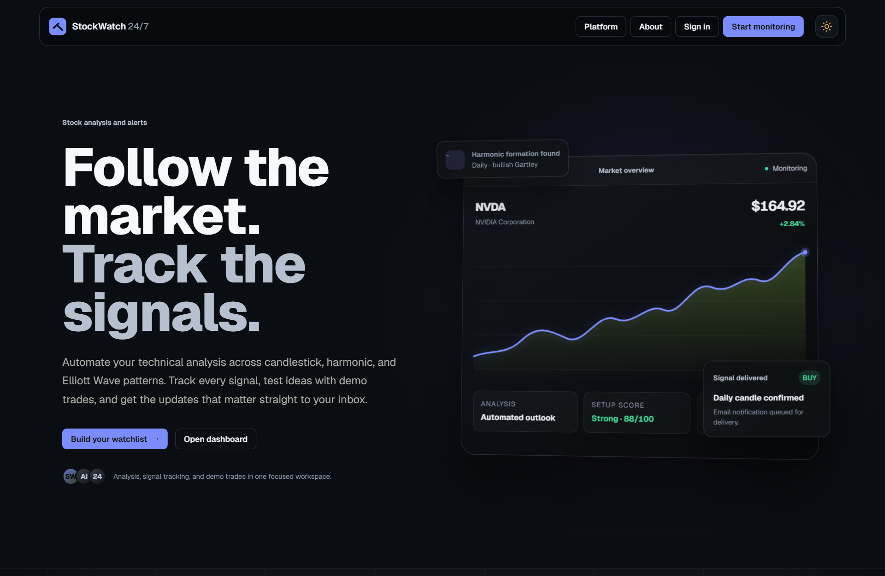](img/landing.png)

The public landing page introduces the product: automated technical analysis across candlestick, harmonic and Elliott Wave patterns, signal tracking, demo trades and email updates.

### Home dashboard

[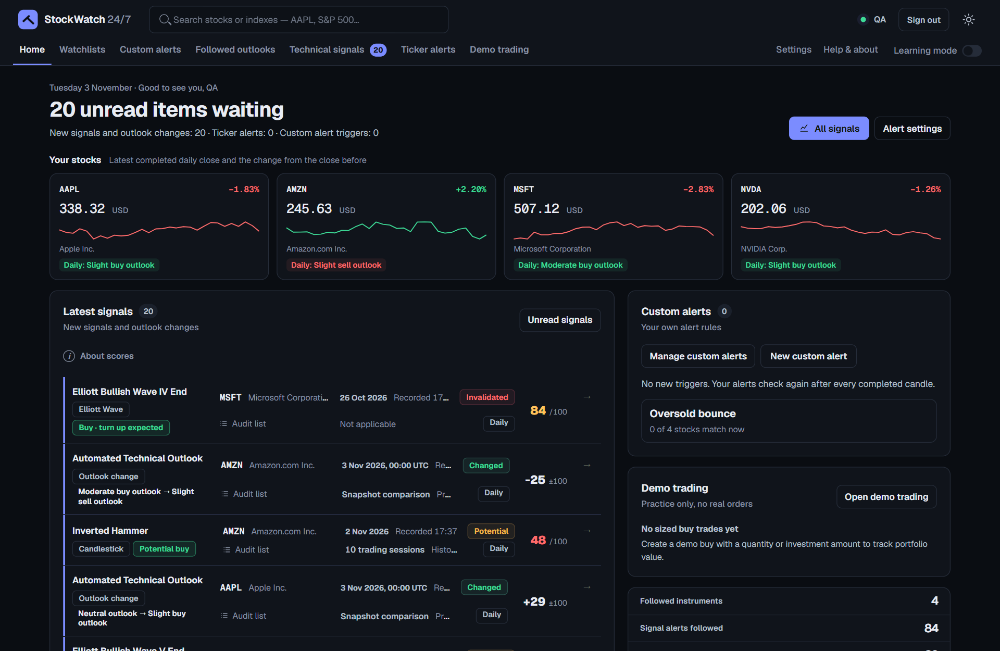](img/home.png)

Home brings everything new into one place. *Your stocks* shows each followed stock's latest daily close, change, sparkline and daily outlook. *Latest signals* lists new patterns and outlook changes with their setup score and status, next to custom alert triggers and the demo-trading portfolio.

### Stock workspace

[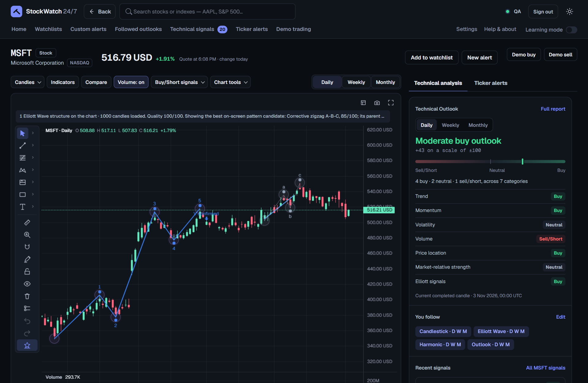](img/stock-workspace.png)

Every stock opens in a chart-first workspace. The toolbar switches chart types, adds indicators, compares symbols and lays pattern signals over the chart. Here MSFT's daily chart shows its Elliott Wave count, with the drawing tools on the left. The panel on the right shows the automated outlook for the daily, weekly or monthly interval, the signals this account follows for the stock, and its recent signals.

## Automated technical analysis

### Technical outlook

[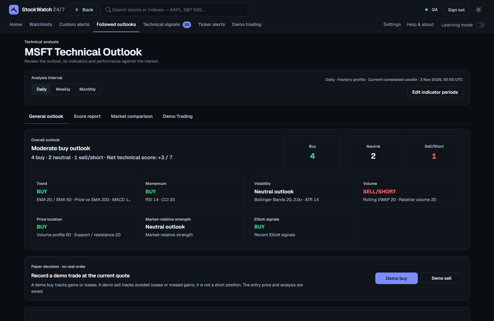](img/technical-outlook.png)

The technical outlook is StockWatch's automated analysis of a stock on one interval. Seven categories each vote buy, neutral or sell/short: trend (EMA 20/50, price against SMA 200, MACD), momentum (RSI 14, CCI 20), volatility (Bollinger Bands, ATR), volume (rolling VWAP, relative volume), price location (volume profile, support and resistance), strength against the market, and recent Elliott and candlestick signals. They combine into one outlook from −100 to +100. The *Score report* tab explains every input, *Market comparison* sets the stock against its broad market, and the indicator periods can be edited. A demo trade can be recorded at the current quote straight from the report.

### Followed outlooks

[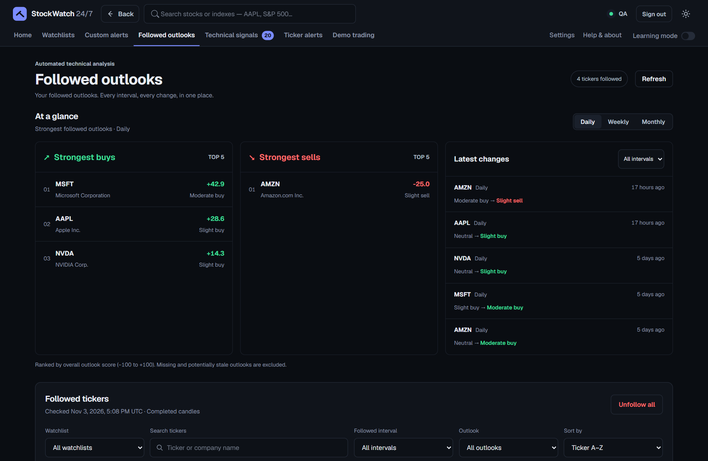](img/followed-outlooks.png)

Followed outlooks rank every followed stock by its outlook score: the five strongest buys and sells, and the latest changes, such as AMZN moving from *Moderate buy* to *Slight sell*. Each change is also a notification on the dashboard.

## Elliott Waves

### Elliott Waves on the chart

[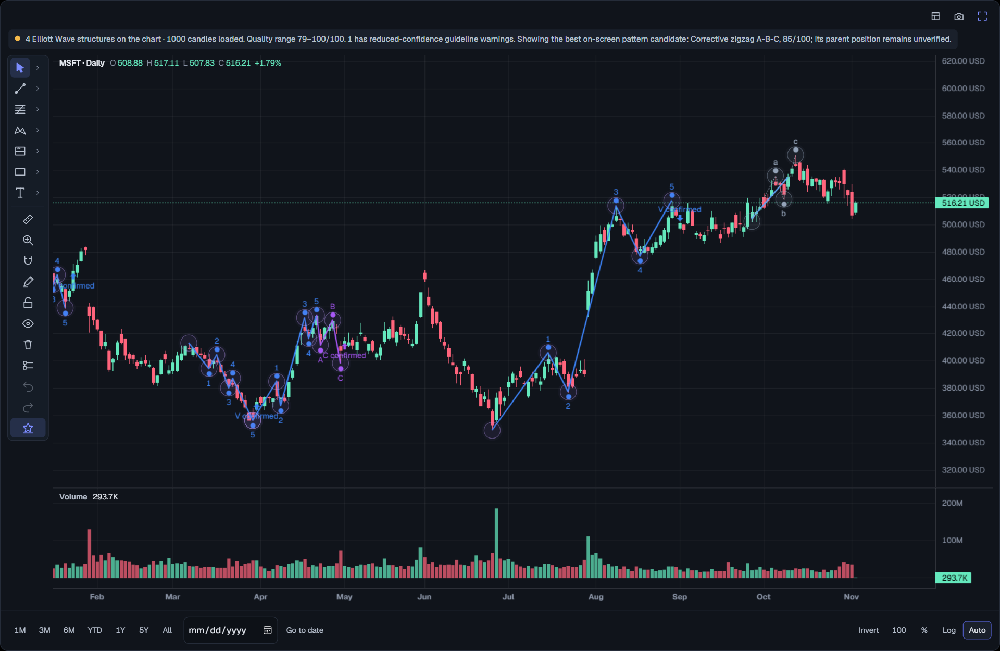](img/elliott-waves.png)

StockWatch counts Elliott Waves on daily, weekly and monthly candles. In full-screen mode the MSFT daily chart shows four structures: motive waves labeled 1–5 and corrections labeled A-B-C, each with its quality score. Confirmed wave ends are marked, structures with guideline warnings are flagged, and fractal subwaves can be switched on.

### Elliott Wave projection

[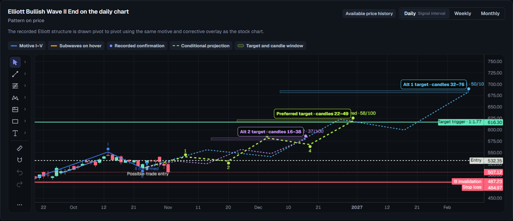](img/elliott-projection.png)

Each Elliott signal has its own page. For this *Bullish Wave II End*, the chart draws the recorded structure, the confirmation, a conditional projection for the next wave, and Fibonacci target zones with candle windows (a preferred target and two alternatives). The entry, invalidation level and stop are drawn on the price axis.

### Signal lifecycle

[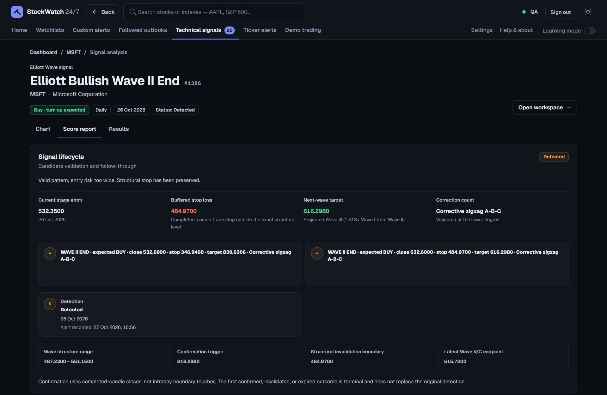](img/signal-score-report.png)

The signal's report follows it from detection onwards: the current-stage entry, buffered stop loss, next-wave target, the correction count, the confirmation trigger and the structural invalidation boundary. Confirmation uses completed-candle closes, and the first confirmed, invalidated or expired outcome is final.

## Harmonic patterns

[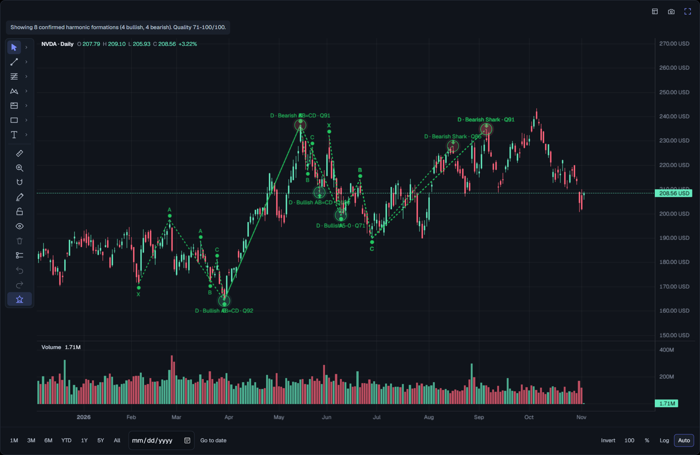](img/harmonic-patterns.png)

The harmonic overlay draws every confirmed harmonic pattern in the loaded history. On this NVDA daily chart there are eight: bearish Sharks, bullish and bearish AB=CDs and a bullish 5-0, each with its X-A-B-C-D points and a quality score (Q71–Q100). StockWatch detects bullish and bearish Gartley, Bat, Alternate Bat, Butterfly, Crab, Deep Crab, Shark, Cypher, 5-0, AB=CD and Alternate AB=CD patterns on daily, weekly and monthly candles. Clicking a pattern opens its details and outcome, with a link to the full historical signal page.

## Candlestick patterns

### Candlestick signals on the chart

[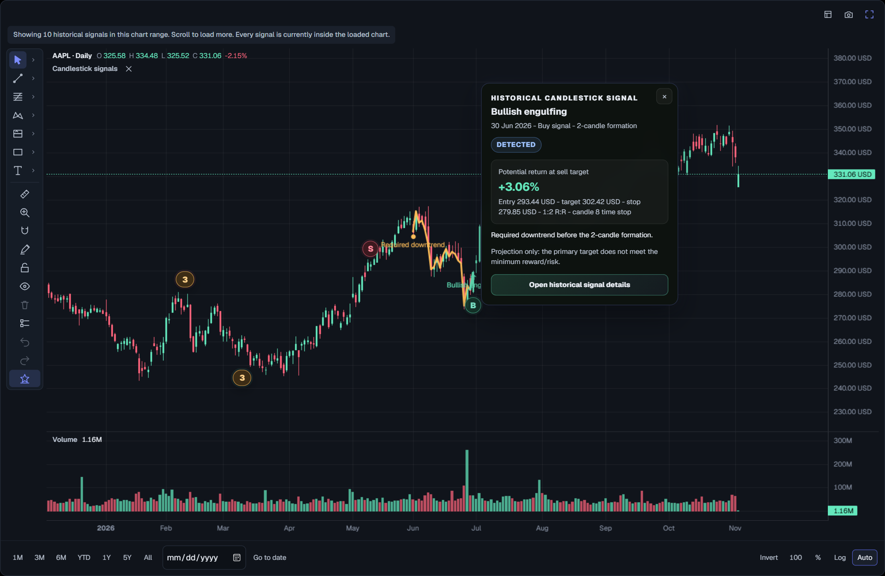](img/candlestick-patterns.png)

The candlestick overlay marks buy (B) and sell (S) signals on the chart; nearby signals are grouped into numbered markers. Clicking a marker opens the signal: here a *Bullish Engulfing* with the required downtrend before it highlighted, its entry, target, stop, reward/risk and time stop. When the target is too close for the minimum reward/risk, the plan is marked *projection only*. StockWatch detects 17 candlestick patterns, from Hammer and Engulfing to Morning Star and Three White Soldiers.

### Candlestick trade plan

[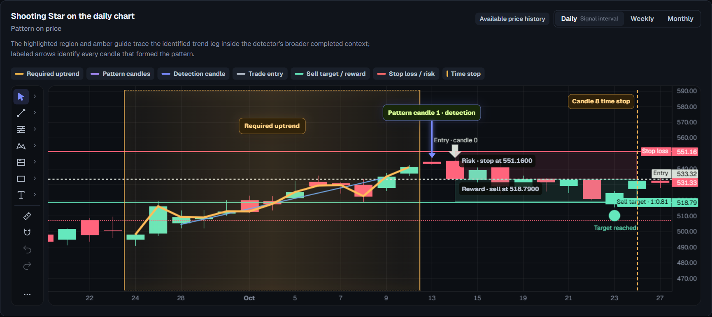](img/candlestick-trade-plan.png)

A candlestick signal's own page draws the whole setup: the required uptrend, the pattern candles, the detection candle, the entry at the next open, the stop loss and risk, the target and reward, and the time stop. This *Shooting Star* reached its target before the time stop.

## Indicators

### Indicators on the chart

[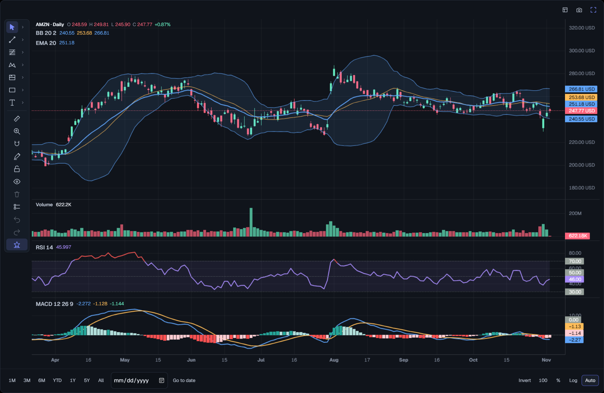](img/indicators.png)

Indicators sit on the price chart or in their own panes, sharing the time axis. This AMZN chart has Bollinger Bands and an EMA 20 on price, with RSI 14 and MACD (12, 26, 9) below the volume. Each indicator has its own inputs, style and visibility, and the legend shows its current values.

### Indicator browser

[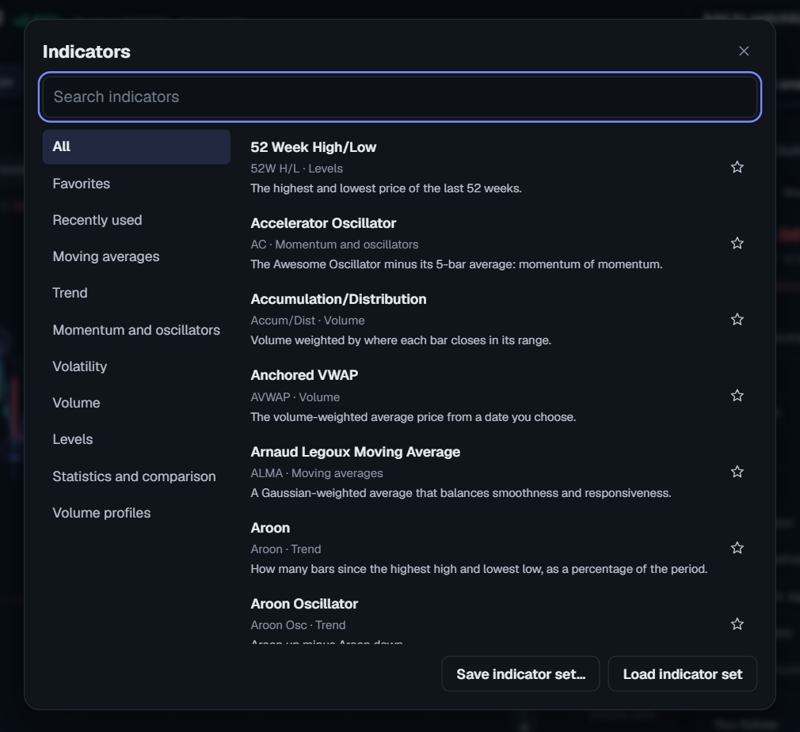](img/indicator-browser.png)

The indicator browser holds 121 indicators in eight groups: moving averages, trend, momentum and oscillators, volatility, volume, levels, statistics and comparison, and volume profiles. Search by name, mark favorites, reuse recent ones, and save the indicators on a chart as a named set to load later.

## Drawing

### Drawing on the chart

[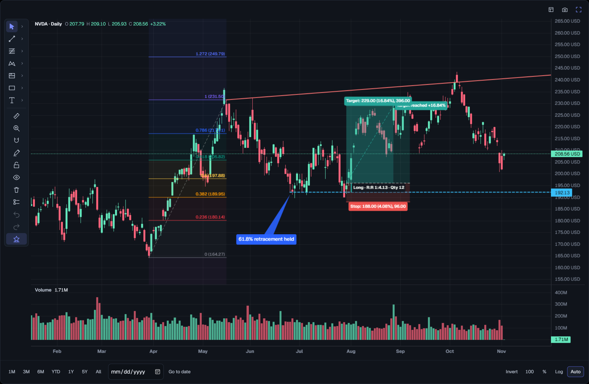](img/drawings.png)

Drawings are saved to the account per stock. On this NVDA chart: a Fibonacci retracement from the March low to the May high, a rising resistance line, a support ray at the June low, a note on the 61.8% retracement, and a long position with its target, stop, reward/risk and quantity. A position drawing can prefill a demo trade.

### Drawing tools

[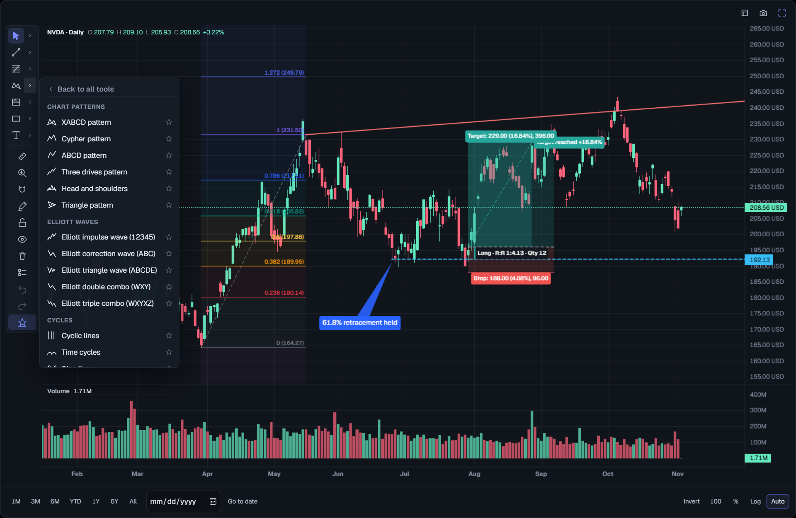](img/drawing-tools.png)

The rail on the left holds 86 drawing tools in 13 groups: lines, channels, pitchforks, cycles, Fibonacci, Gann, chart patterns, Elliott Waves, positions, measuring and volume tools, shapes and annotations. The open menu shows the pattern tools (XABCD, Cypher, ABCD, three drives, head and shoulders, triangle) and the Elliott Wave counts (impulse, correction, triangle, double and triple combinations). Below them are the measure, zoom, magnet, lock, hide, delete, object list, undo and redo controls.

## Custom alerts

### Custom alerts

[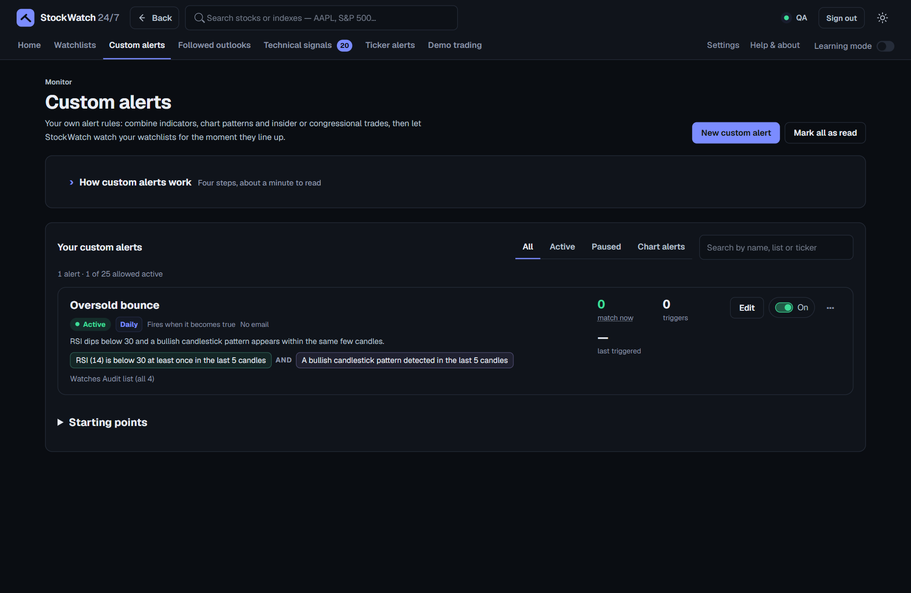](img/custom-alerts.png)

Custom alerts are your own rules. Each one shows whether it is active, its interval, when it fires, whether it emails, its conditions in plain language, which watchlists it watches, how many stocks match now and how often it has triggered. *Starting points* offer ready-made rules, and the *Chart alerts* tab lists alerts set on drawings and indicators from the chart.

### Custom alert builder

[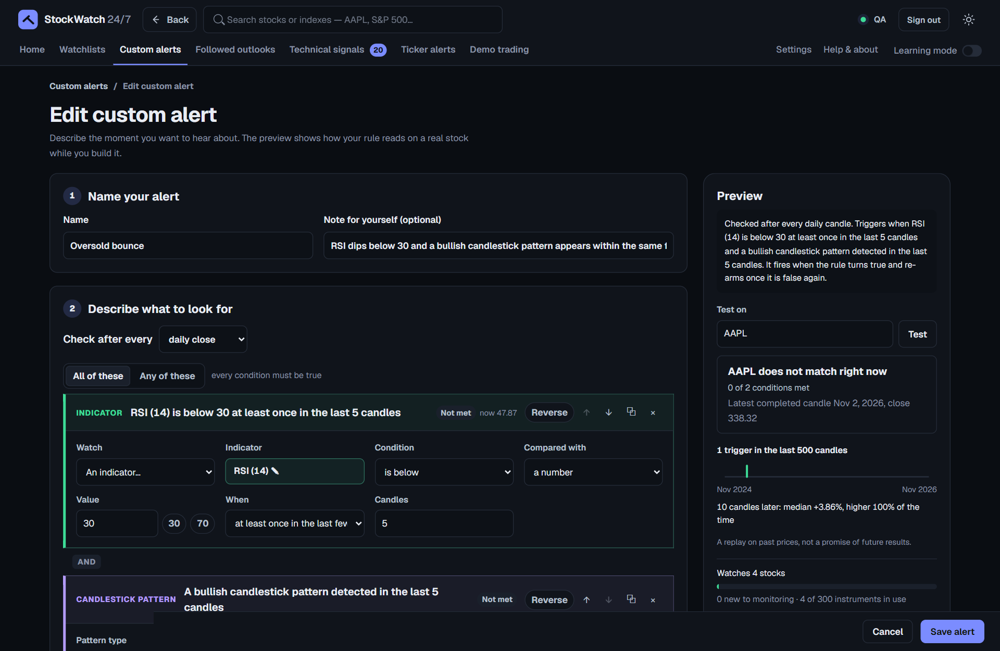](img/custom-alert-builder.png)

The builder describes the moment to look for. This *Oversold bounce* alert is checked after every daily close and needs both conditions: RSI (14) below 30 at least once in the last 5 candles, and a bullish candlestick pattern in the same window. Conditions can use price, indicators, candlestick, Elliott Wave and harmonic patterns, the automated outlook, and insider and congressional trades. The preview restates the rule in plain language, tests it on a real stock (AAPL meets 0 of 2 conditions now), and replays it over the last 500 candles: one trigger, with a median move of +3.86% ten candles later.

## Signals, watchlists and demo trading

### Signal archive

[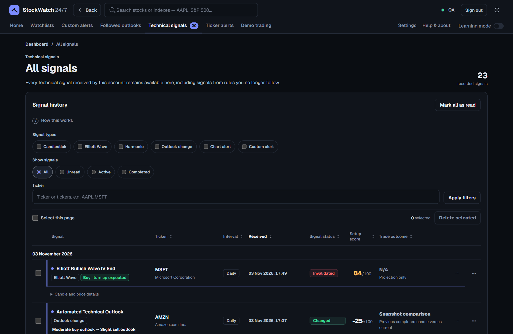](img/signals.png)

Every signal the account receives stays in the archive, including signals from rules that are no longer followed. Filter by type (candlestick, Elliott Wave, harmonic, outlook change, chart alert, custom alert), by status and by ticker, and sort by signal status, setup score or trade outcome.

### Ticker alerts

[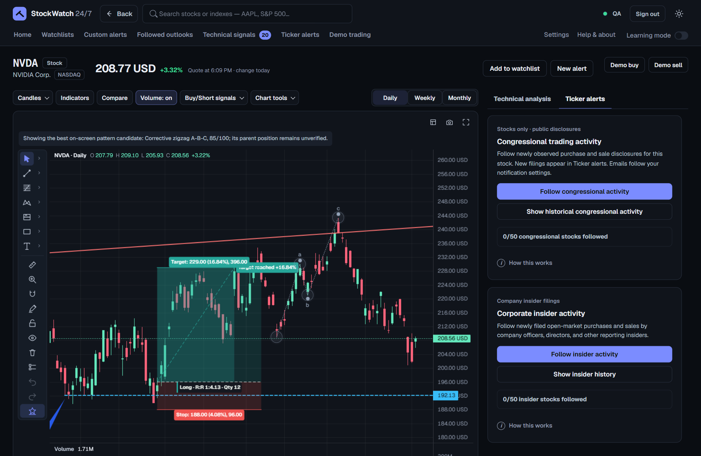](img/ticker-alerts.png)

The *Ticker alerts* tab of a stock follows purchases and sales reported by members of Congress and by company insiders, and opens their history. New filings appear on the dashboard and can be emailed.

### Watchlist

[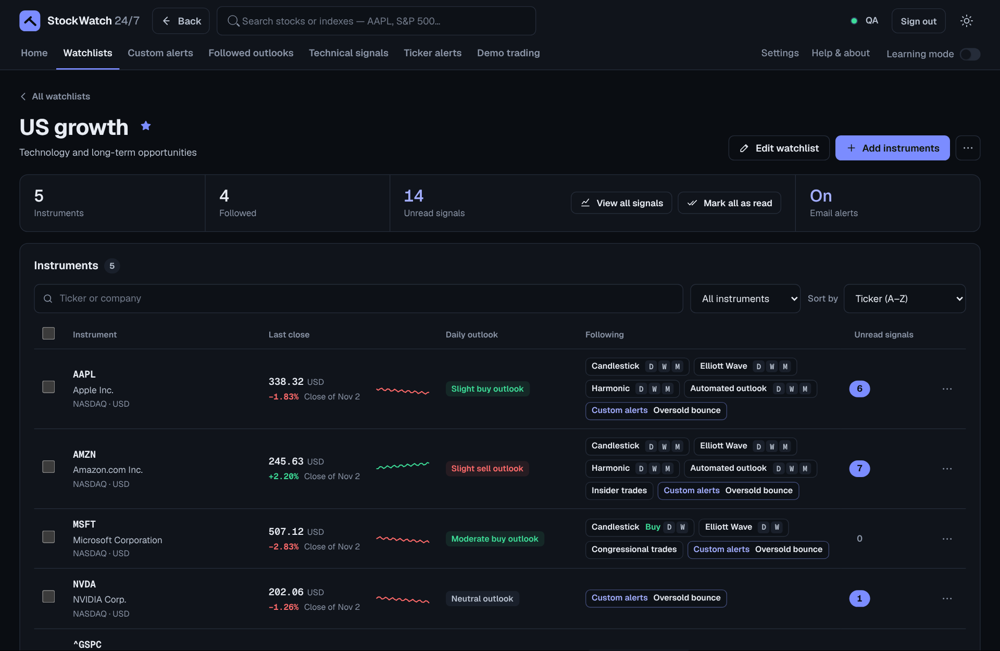](img/watchlist.png)

A watchlist shows each member's last close, daily change, sparkline and outlook, and exactly what is followed for it: candlestick, Elliott Wave and harmonic buy and sell signals per interval, the automated outlook, and the custom alerts that watch the list.

### Demo trading

[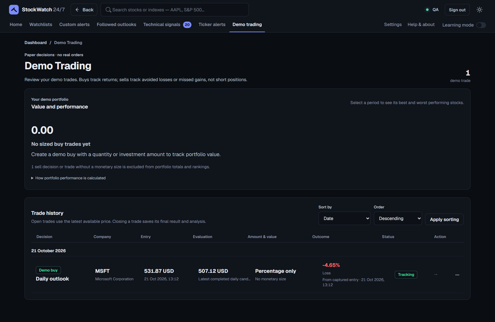](img/demo-trading.png)

Demo trading records hypothetical buys and sells at the current quote. Buys track returns; sells track avoided losses or missed gains. A trade can carry a stop and target and then closes by itself when a completed candle reaches either level. No real orders are placed.

### Light theme

[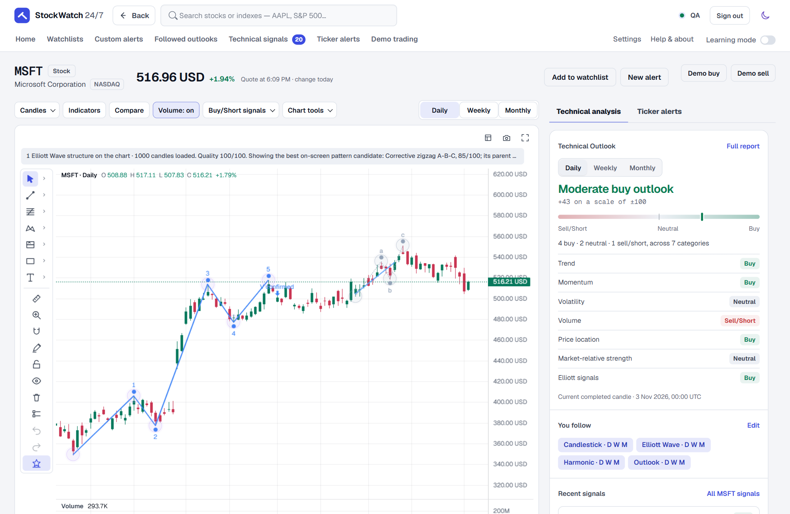](img/light-theme.png)

Every page has a light and a dark theme, saved per account. The app is available in English and Polish, and an optional learning mode explains terms and options in plain language.

## Continue exploring

Return to the [main README](README.md) for the feature list, setup, configuration and testing instructions.
