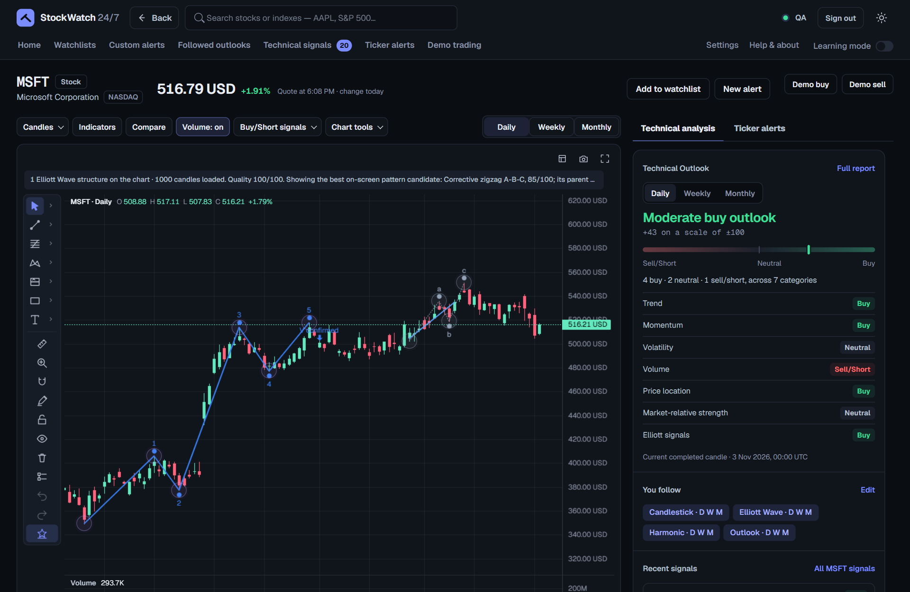
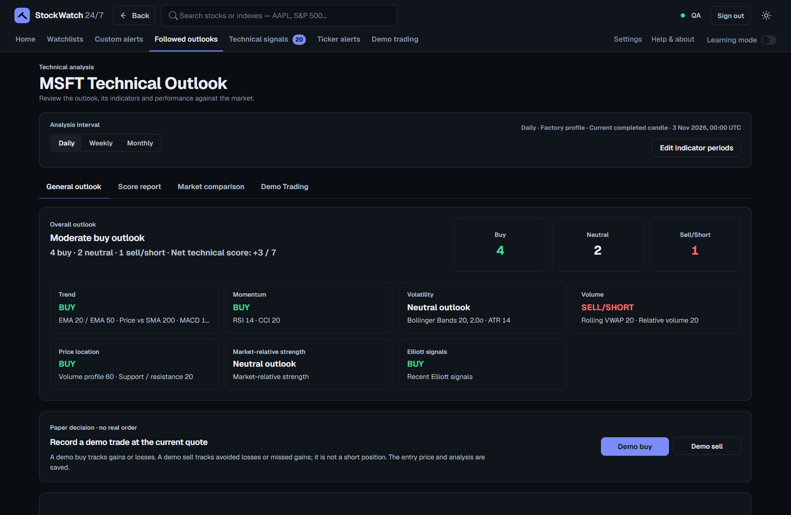
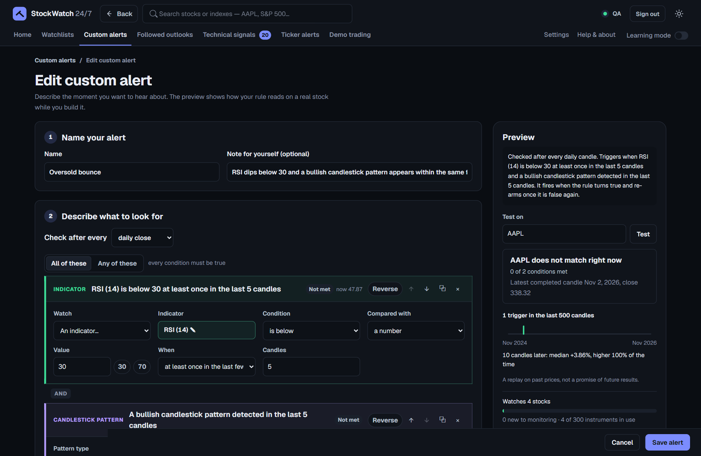
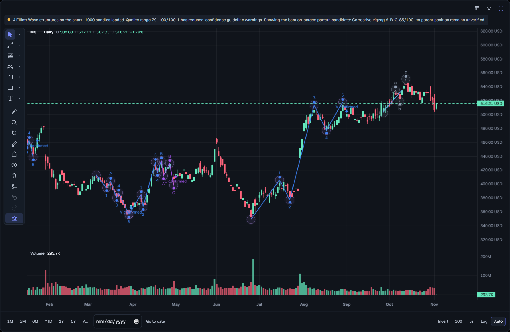
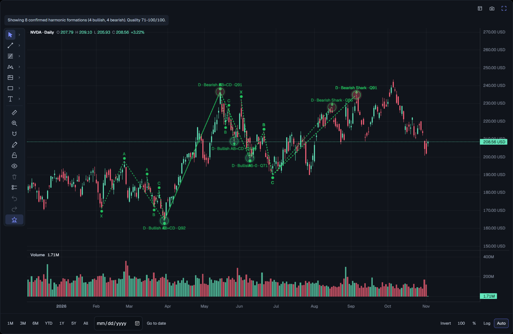
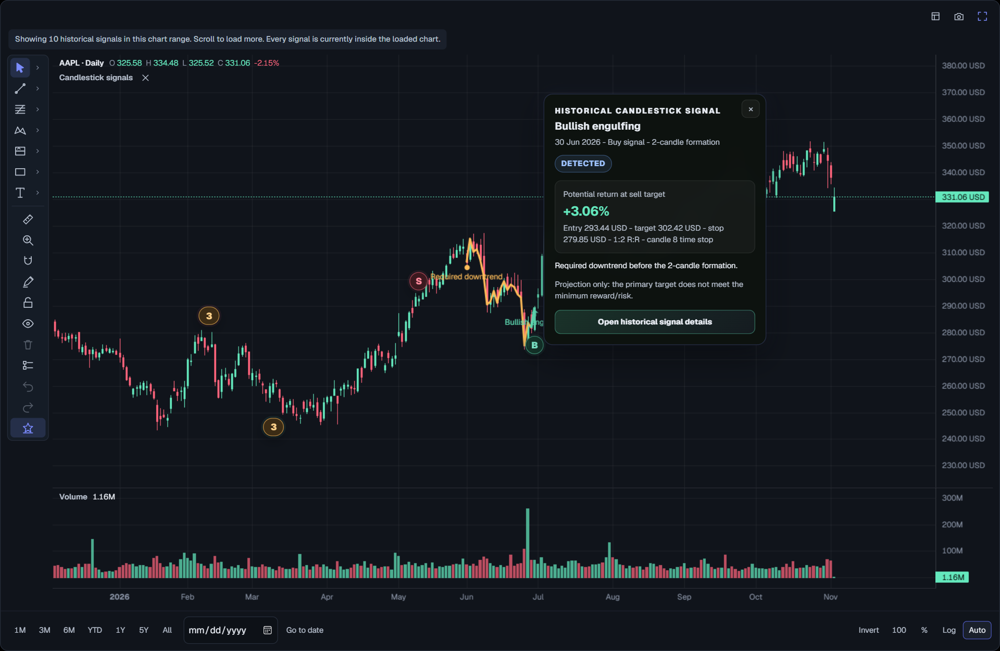
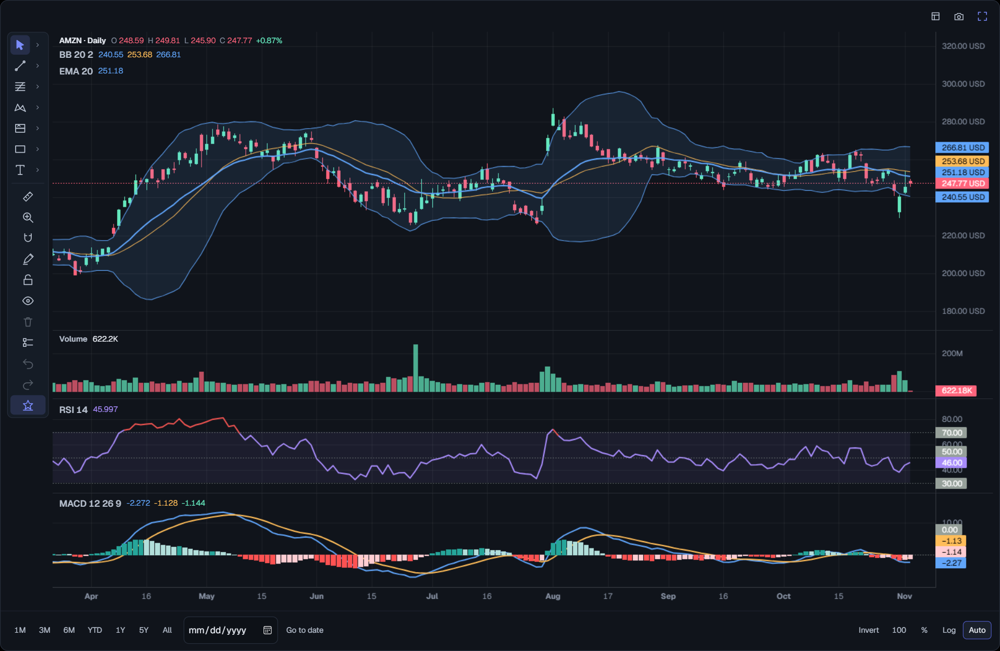
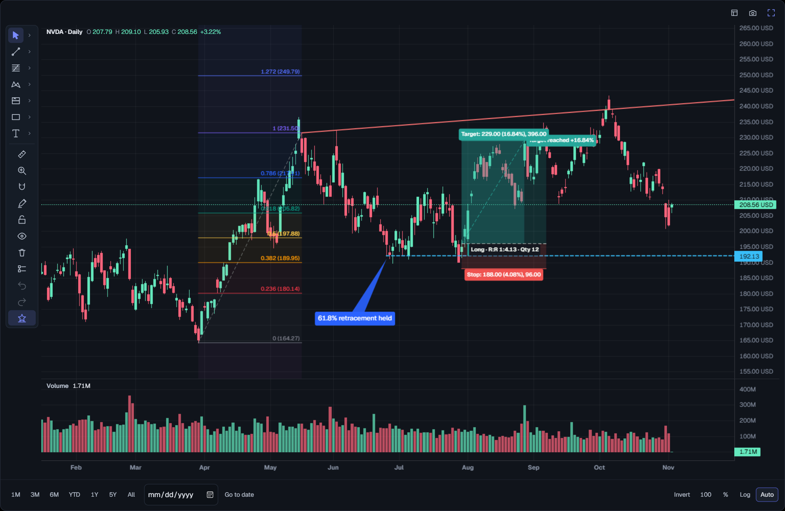
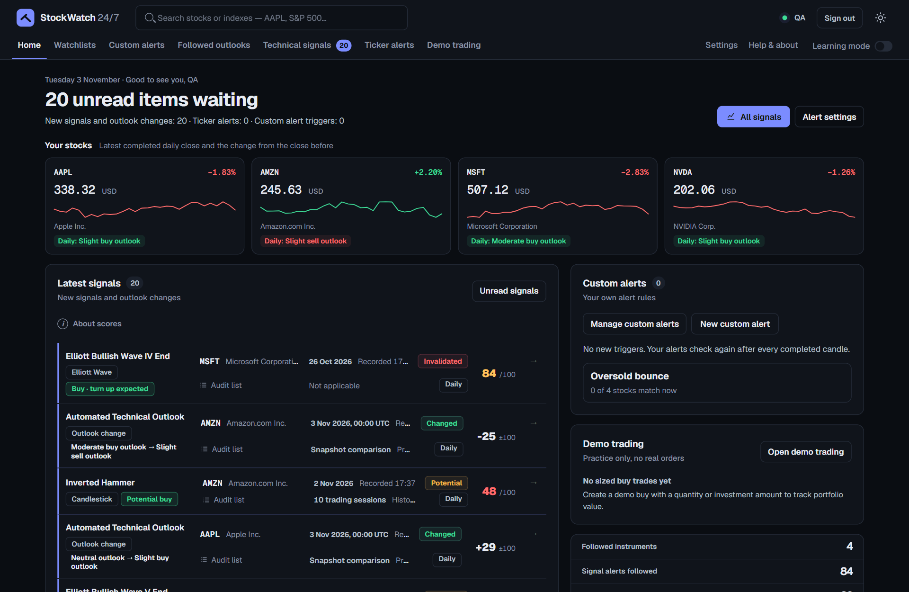

# StockWatch 24/7

**Automated technical analysis and custom alerts for the stocks you follow.**

StockWatch 24/7 watches your watchlists around the clock. After every completed daily, weekly and monthly candle it runs a full technical analysis: candlestick patterns, Elliott Waves, harmonic patterns and a technical outlook built from trend, momentum, volatility and volume indicators. When something you follow appears, you get an email and a dashboard notification with the pattern drawn on the chart, a setup score, and an entry, stop and target. You can also write your own alerts that combine indicators, patterns and insider or congressional trades. A charting workspace with 121 indicators and 86 drawing tools covers your own analysis.

[](DEMO.md)

### [Open the 22-screen visual demo &rarr;](DEMO.md)

> StockWatch 24/7 is provided for educational and informational purposes. It is not financial advice. Scores, outlooks and trade plans are rule-based measurements, not predictions or probabilities of profit.

## Features at a glance

<table>
  <tr>
    <td width="50%" valign="top">
      <a href="DEMO.md#technical-outlook"></a>
      <br><b>Automated technical analysis</b><br>A buy, neutral or sell outlook scored from −100 to +100 across seven indicator categories, for each interval.
    </td>
    <td width="50%" valign="top">
      <a href="DEMO.md#custom-alert-builder"></a>
      <br><b>Custom alerts</b><br>Combine indicators, chart patterns and insider or congressional trades. A live preview tests the rule against past candles.
    </td>
  </tr>
  <tr>
    <td width="50%" valign="top">
      <a href="DEMO.md#elliott-waves-on-the-chart"></a>
      <br><b>Elliott Waves</b><br>Impulse waves 1–5 and A-B-C corrections are counted and labeled on the chart, with Fibonacci targets and projections.
    </td>
    <td width="50%" valign="top">
      <a href="DEMO.md#harmonic-patterns"></a>
      <br><b>Harmonic patterns</b><br>Gartley, Bat, Butterfly, Crab, Shark, Cypher, 5-0 and AB=CD patterns with labeled X-A-B-C-D points and a quality score.
    </td>
  </tr>
  <tr>
    <td width="50%" valign="top">
      <a href="DEMO.md#candlestick-patterns"></a>
      <br><b>Candlestick patterns</b><br>17 patterns, from Hammer and Engulfing to Morning Star and Three White Soldiers, each checked for the trend before it.
    </td>
    <td width="50%" valign="top">
      <a href="DEMO.md#indicators"></a>
      <br><b>Indicators</b><br>121 indicators in eight groups, on the price chart or in their own panes, with saved indicator sets.
    </td>
  </tr>
  <tr>
    <td width="50%" valign="top">
      <a href="DEMO.md#drawing-on-the-chart"></a>
      <br><b>Drawing</b><br>86 drawing tools: trend lines, Fibonacci and Gann tools, pitchforks, positions, pattern and Elliott tools, shapes and notes.
    </td>
    <td width="50%" valign="top">
      <a href="DEMO.md#home-dashboard"></a>
      <br><b>One dashboard</b><br>Followed stocks, new signals, outlook changes, custom alert triggers and demo trades in one place.
    </td>
  </tr>
</table>

## What StockWatch does

### Automated technical analysis

- **Technical outlook.** Every stock gets an overall outlook on the daily, weekly and monthly interval, scored from −100 to +100. Seven categories feed it: trend (EMA 20/50, price against SMA 200, MACD), momentum (RSI, CCI), volatility (Bollinger Bands, ATR), volume (rolling VWAP, relative volume), price location (volume profile, support and resistance), strength against the market, and recent pattern signals. Indicator periods can be edited.
- **Score report and market comparison.** Each outlook explains every input, and compares the stock with its market index.
- **Followed outlooks.** Follow an outlook to see your strongest buys and sells at a glance and to be notified when an outlook changes, for example from *Moderate buy* to *Slight sell*.
- **Setup scores.** Every detected pattern gets a 0–100 setup score from confluence with trend, higher-timeframe context, momentum, Bollinger location, support and resistance, relative volume, VWAP and volume profile. The score ranks patterns; it never creates or suppresses one.
- **Trade plans and outcome tracking.** Signals carry an entry at the next candle's open, a structural stop, a target, a reward/risk ratio and a time stop. StockWatch then follows each signal to its result: confirmed, invalidated or expired, target or stop reached. See the [trade-plan risk model](docs/trade-plan-risk-model.md).

### Pattern detection

- **Candlestick patterns** on daily, weekly and monthly candles: Bullish and Bearish Engulfing, Doji, Hammer, Inverted Hammer, Hanging Man, Shooting Star, Morning and Evening Star, Piercing Line, Dark Cloud Cover, Bullish and Bearish Harami and Harami Cross, Three White Soldiers and Three Black Crows. Detection checks the candle geometry and the trend the pattern needs before it. Each detection is sent immediately, then a follow-up reports whether it was confirmed, invalidated or expired.
- **Elliott Waves** on daily, weekly and monthly candles: impulse waves with the ends of waves II, III, IV and V (truncated fifths included), and zigzag, flat, expanded flat and running flat corrections. Fractal subwaves can be shown, developing cycles send notifications as each wave completes, and [adaptive projections](docs/adaptive-elliott-projections.md) draw Fibonacci target zones for the next wave.
- **Harmonic patterns** on daily, weekly and monthly candles: bullish and bearish Gartley, Bat, Alternate Bat, Butterfly, Crab, Deep Crab, Shark, Cypher, 5-0, AB=CD and Alternate AB=CD, each with its X-A-B-C-D points, ratios, quality score and a structural stop. See [harmonic formations](docs/harmonic-formations.md).
- **On the chart.** Candlestick signals, Elliott structures and harmonic patterns can be laid over any stock's chart, including their history. Click a pattern for its details and trade plan.
- **Your settings.** Candlestick, Elliott Wave and harmonic detection, scoring and stop placement can be tuned per account in Settings.

### Custom alerts

- **Rules in plain language.** Build an alert from conditions such as "RSI (14) is below 30 at least once in the last 5 candles", "a bullish Elliott Wave II end in the last 5 candles" or "insiders bought in the last 30 days". Join them with *All of these* or *Any of these*.
- **Indicators, patterns and trades.** Conditions can use price, 104 indicators, candlestick, Elliott Wave and harmonic patterns, the automated outlook, and insider and congressional trades: up to 12 conditions in up to 4 groups, and up to 25 active alerts per account.
- **When it fires.** When the whole rule becomes true (it re-arms once it is false again), once per stock, or on every candle.
- **Live preview.** While you build an alert, the preview shows whether a real stock matches now, how often the rule triggered over the last 500 candles, and how the price moved afterwards.
- **Watchlists.** Point an alert at whole watchlists, so stocks you add later are included, or at chosen stocks. Each trigger lists the value that met every condition and keeps measuring the price move afterwards.
- **Chart alerts.** Put an alert on a drawn line or shape, or on an indicator, straight from the chart.
- **Followed signals.** For the built-in detectors, follow buy and sell signals per pattern family and interval on any stock or watchlist.

### Charting

- **Indicators.** 121 indicators in eight groups: moving averages, trend, momentum and oscillators, volatility, volume, levels (pivots, auto Fibonacci, auto trend lines and pitchforks), statistics and comparison (including custom formulas), and volume profiles. Each has its own inputs, style and visibility, and indicator sets can be saved and loaded.
- **Drawing.** 86 tools in 13 groups: lines, channels, pitchforks, cycles, Fibonacci, Gann, chart patterns (XABCD, Cypher, ABCD, three drives, head and shoulders, triangle), Elliott Wave counts, long and short positions, measuring tools, volume tools, shapes and annotations. Drawings are saved to your account per stock, with undo, magnet, lock and hide.
- **Chart types and tools.** 15 chart types, including Heikin Ashi, Renko, Kagi, line break and point & figure. Compare symbols, anchored volume profile with POC and value area, data window, log and percentage scales, full screen, and chart images.

### Also included

- **[Named watchlists](docs/named-watchlists.md)** with index imports, pasted ticker lists, each member's latest close, daily change, sparkline and outlook, and per-list follows.
- **Signal archive.** Every signal stays available, filterable by type, status and ticker, with its setup score and trade outcome.
- **Demo trading.** Record hypothetical buys and sells at the current quote, with an optional stop and target prefilled from a position drawing or a signal's trade plan. A trade closes by itself when a completed candle reaches either level. Nothing is a real order.
- **Ticker alerts.** Follow congressional purchases and sales and corporate insider filings for a stock, with history and email notifications.
- **Email.** One email per signal or one summary per check run, a setting per account.
- **Light and dark themes**, English and Polish, and an optional learning mode that explains terms and options in plain language.
- **Accounts.** Signup with email verification, authenticator-app sign-in, and sessions kept in PostgreSQL so restarts keep people signed in.

## Under the hood

- Twelve Data market data with Yahoo Finance fallback, shared quote caching, distributed rate limits and provider cooldowns
- Durable PostgreSQL alert jobs with retries, leases and missed-run recovery: if the application is offline when a daily, weekly or monthly check should run, it rebuilds the missed schedule after restart, processes the backlog oldest-first, and evaluates the candles that were available at each original scheduled time
- Flyway database migrations and a restricted production database-role model
- Production HTTPS/proxy validation, security headers and bounded request sizes
- GitHub Actions tests, CodeQL, dependency auditing and secret scanning

## Technology

- Java 25
- Spring Boot 4.1
- Spring Security, Spring Data JPA, Thymeleaf, and Spring Mail
- PostgreSQL 16 and Flyway
- TA4J
- TradingView Lightweight Charts (bundled under `static/js/vendor`)
- Maven Wrapper
- Docker Compose for the local database

## Requirements

- JDK 25
- Docker Desktop or another Docker Compose installation
- An SMTP account if email delivery is enabled
- A Twelve Data API key for Twelve Data-backed search and market data; Yahoo Finance fallback remains available where supported
- CongressInvests access for congressional activity (the current free REST tier does not require an API key)
- An API Ninjas key for corporate insider filings (optional; the feature can be switched off with `INSIDER_ACTIVITY_ENABLED=false`)

## Local setup

1. Clone the repository and enter it:

   ```powershell
   git clone <repository-url>
   Set-Location StockWatch24-7
   ```

2. Create your ignored local environment file:

   ```powershell
   Copy-Item .env.example .env
   ```

3. Edit `.env` and replace every placeholder credential. For the local Compose database, use the same local role for runtime and migrations:

   ```text
   DB_USERNAME=uptodate
   DB_PASSWORD=<strong-local-password>
   DB_MIGRATION_USERNAME=uptodate
   DB_MIGRATION_PASSWORD=<same-strong-local-password>
   ```

   Production deployments should use separate runtime and migration roles as described in the deployment guide.

4. Start PostgreSQL:

   ```powershell
   docker compose up -d postgres
   ```

5. Start the application:

   ```powershell
   .\mvnw.cmd spring-boot:run "-Dspring-boot.run.profiles=dev"
   ```

6. Open [http://localhost:8080](http://localhost:8080).

The `dev` profile is for `http://localhost` only: it turns off HTTPS enforcement and allows the built-in MFA key. Without a profile the app runs the production checks and refuses to start until they pass. Flyway applies pending migrations automatically in development.

## Email alerts

Email delivery is disabled by default. To enable it, configure these values in `.env`:

```text
ALERTS_EMAIL_ENABLED=true
ALERTS_EMAIL_FROM=no-reply@example.com
SMTP_HOST=smtp.example.com
SMTP_PORT=587
SMTP_USERNAME=<smtp-user>
SMTP_PASSWORD=<smtp-password>
SMTP_AUTH=true
SMTP_STARTTLS=true
SMTP_STARTTLS_REQUIRED=true
MFA_ENCRYPTION_KEY=<at-least-32-random-characters>
```

`MFA_ENCRYPTION_KEY` protects authenticator-app secrets at rest. Keep it stable across restarts and instances; changing or losing it makes existing authenticator enrollments unreadable. Production refuses to start with a missing or placeholder key.

Each alert rule belongs to a user. A scheduled symbol/interval check is shared, but every matching active rule is evaluated independently and mail is sent to each rule owner's address. Users' laptops do not need to remain online.

Directional candlestick detections also start an additive lifecycle. The initial
`DETECTED` email is never delayed or suppressed. Over the next three completed
candles by default, the first close beyond the frozen pattern range produces
either a `CONFIRMED` or `INVALIDATED` email; a setup that crosses neither
boundary becomes `EXPIRED`. Pending lifecycle events remain durably scheduled
through restarts and missed-run recovery. Elliott Wave and harmonic signals
follow their own trade-plan lifecycle, described in the
[trade-plan risk model](docs/trade-plan-risk-model.md).

## Congressional activity

Congressional purchase and sale disclosures are read through the free
[CongressInvests](https://congressinvests.com/) REST API. The feature is
stock-only and uses one canonical PostgreSQL record for both historical views
and alerts:

1. A history request checks shared database coverage first. A provider request
   is made only when the cache is missing or stale, including when the valid
   result is empty. After any provider refresh attempt, successful or failed,
   that ticker remains on cooldown until midnight UTC. Cached requests remain
   available and do not consume refresh quota.
2. Switching on a follow establishes a historical baseline. Backfilled records
   never generate old emails.
3. A shared poll runs at most once every six hours across the deployment.
   Newly observed disclosures are deduplicated, shown on the dashboard, and
   queued for durable email delivery.
4. The application enforces a default provider budget of 90 requests per UTC
   day across all instances, below the current free-tier limit of 100.
5. Each user can trigger at most two uncached ticker refreshes per minute.
   Congressional API routes also retain the general 30-request-per-minute
   guard.

The UI explicitly limits history to the provider's current 365-day free-tier
window and notes that STOCK Act disclosures may arrive up to 45 days after a
transaction. This data is informational only and is not financial advice.

CongressInvests currently lists white-label/embedding rights under its
Enterprise offering and the underlying official sources have their own usage
terms. Before monetizing, advertising, redistributing, or embedding this
feature commercially, obtain the appropriate written commercial rights and
upgrade the provider agreement. The provider is isolated behind
`CongressionalTradeProvider` so it can be replaced without changing the
subscription, cache, dashboard, or delivery model.

## Durable schedule recovery

Daily, weekly, and monthly schedule occurrences are checkpointed in PostgreSQL. On startup and during periodic recovery checks, the application:

1. Finds cron occurrences missed while the server was offline.
2. Creates each logical run only once, including when multiple app instances start together.
3. Queues one check per active symbol/interval and per symbol/interval with a pending candlestick lifecycle.
4. Processes a symbol's backlog in its original order.
5. Uses the original `scheduled_for` time as the candle-data cutoff.
6. Reclaims work left in progress after an expired worker lease.

The default recovery batch is 100 schedule occurrences per pass, preventing an extended outage from producing an unbounded startup burst.

## Configuration

The complete development template is in [`.env.example`](.env.example). Important settings include:

| Setting | Purpose |
| --- | --- |
| `DB_URL`, `DB_USERNAME`, `DB_PASSWORD` | Runtime PostgreSQL connection |
| `DB_MIGRATION_USERNAME`, `DB_MIGRATION_PASSWORD` | Flyway migration role |
| `TWELVE_DATA_API_KEY` | Twelve Data access |
| `ANCHORED_VOLUME_PROFILE_PRICE_BINS` | Price rows used by the estimated anchored profile (default `48`) |
| `ANCHORED_VOLUME_PROFILE_VALUE_AREA_PERCENT` | Volume percentage enclosed by VAH/VAL (default `70`) |
| `ANCHORED_VOLUME_PROFILE_MAXIMUM_LIVE_REFRESHES` | Per-user provider refreshes for a ticker and active candle (fixed maximum `2`) |
| `ALERTS_EMAIL_ENABLED` | Enables signal and verification email delivery |
| `SMTP_*` | SMTP transport and STARTTLS settings |
| `MFA_ENCRYPTION_KEY` | Stable production secret used to encrypt authenticator-app seeds |
| `ALERT_SCHEDULE_ENABLED` | Enables scheduled alert recovery and workers |
| `ALERT_JOB_LEASE_SECONDS` | Worker lease before abandoned work can be reclaimed |
| `ALERT_CATCH_UP_BATCH_SIZE` | Maximum missed schedule occurrences recovered per pass |
| `CONGRESSIONAL_ACTIVITY_ENABLED` | Enables stock-only congressional history and follows |
| `CONGRESSIONAL_ACTIVITY_MAX_UNCACHED_REFRESHES_PER_USER_PER_MINUTE` | Per-user uncached ticker refresh ceiling (default `2`); cache hits do not count |
| `CONGRESS_INVESTS_DAILY_REQUEST_BUDGET` | Shared UTC daily call ceiling (default `90`) |
| `CONGRESS_INVESTS_API_KEY` | Optional paid-plan key; leave blank on the free tier |
| `INSIDER_ACTIVITY_ENABLED` | Enables corporate insider filing history and follows |
| `API_NINJAS_API_KEY` | API Ninjas key for insider filings |
| `CONGRESSIONAL_ACTIVITY_POLL_INTERVAL_HOURS` | Minimum interval between shared provider polls (default `6`) |
| `SPRING_PROFILES_ACTIVE=prod` | Enables production security requirements |

Never commit `.env`, database passwords, SMTP credentials, or API keys. Store production secrets in the hosting platform's secret manager.

## Testing

Run the complete test suite:

```powershell
.\mvnw.cmd test
```

Run the dependency security gate:

```powershell
.\mvnw.cmd -Psecurity-scan -DskipTests verify
```

Some historical backtests are intentionally opt-in through their documented JVM system properties and are skipped during the regular test suite.

## Production deployment

Production requires the `prod` Spring profile, HTTPS behind a trusted reverse proxy, secure SMTP, and separate database roles. Run the one-shot Flyway migration process before starting a runtime instance with migrations disabled.

See [Secure deployment checklist](docs/security-deployment.md) for the required environment, migration command, Nginx example, network boundaries, and release checks.

## Contributions

StockWatch 24/7 is proprietary software. Unsolicited code contributions are not accepted unless the contributor first signs a written agreement that gives the project owner the rights required to incorporate and commercially license the contribution.

## License

Copyright © 2026 Jan Gradkowski. All rights reserved.

StockWatch 24/7 is proprietary software. No permission is granted to use, copy, modify, distribute, sublicense, sell, host, or create derivative works without a separate written, paid commercial license from the copyright owner. See the [StockWatch 24/7 Proprietary Commercial License](LICENSE).

Revisions previously distributed under the Apache License, Version 2.0 remain under that license; the proprietary license applies prospectively from the repository revision in which it was introduced. Third-party components remain governed by their own licenses.
